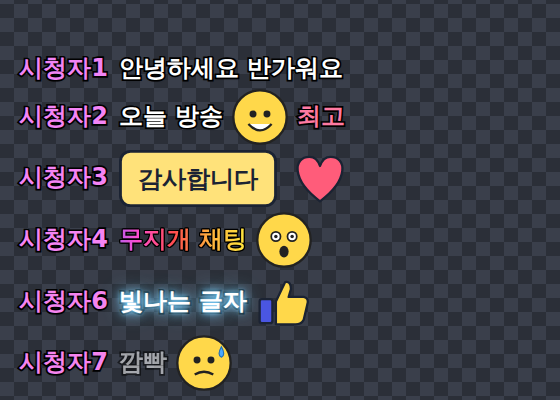
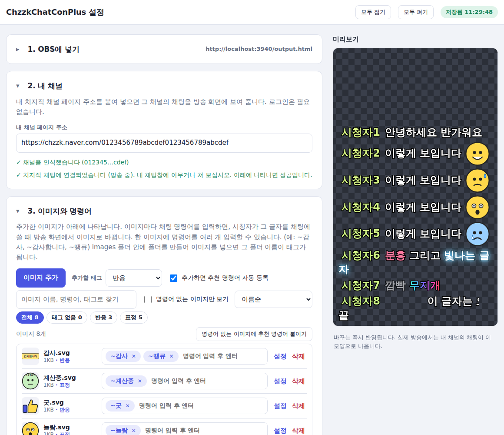
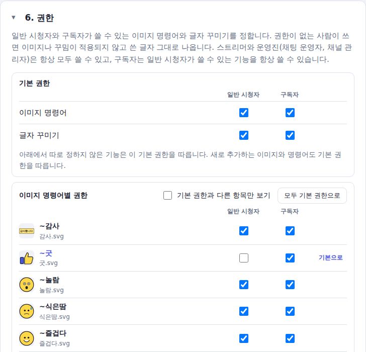

# ChzzkChatConPlus

치지직 채팅에서 `~감사` 같은 **명령어를 이미지로**, `[color=red]글자[/color]` 같은 **BBCode를 꾸민 글자로** 바꿔서 OBS 방송 화면에 보여 주는 채팅 오버레이입니다.
설치도 로그인도 필요 없이 `.exe` 파일 하나로 실행됩니다.



> **비공식 프로젝트입니다.** NAVER 및 치지직과 관련이 없습니다. "알아 두실 점"을 꼭 읽어 주십시오.

<details>
<summary><b>스트리머용</b></summary>

### 주요 기능

- **이미지 명령어**: 채팅에 쓴 명령어(`~감사`)가 채팅 줄 안에서 이미지로 바뀝니다. 한 이미지에 명령어를 여러 개(`~감사`, `~감사합니다`, `~땡큐`) 붙일 수 있습니다.
  - 이미지를 추가하면 **파일 이름으로 만든 추천 명령어가 자동 등록**됩니다. (끌 수 있고, 한꺼번에 붙이는 버튼도 있습니다.)
  - 명령어 이미지의 **기본 높이**를 한 번에 정하고, 이미지마다 예외를 둘 수 있습니다.
- **이미지 태그**: `images` 폴더 안의 폴더 이름이 태그가 됩니다. 태그별 필터, 정렬, 검색을 지원하고, 앱 안에서 태그를 바꾸면 파일을 대신 옮겨 줍니다.
- **글자 꾸미기(BBCode)**: 굵게, 색, 크기, 배경, 테두리, 그라데이션과 여러 움직이는 효과. 한글 이름(`[무지개]`)과 단축 이름(`[rb]`)을 기본으로 쓸 수 있고, 닫는 태그는 생략할 수 있습니다. 남용을 막는 한도(중첩, 개수, 크기)가 있습니다.
- **숨길 채팅**: 치지직 채팅창에는 보이지만 방송 화면에서는 숨길 채팅(예: 다른 봇의 `!명령어`)을 정합니다.
- **권한**: 일반 시청자와 구독자가 쓸 수 있는 이미지 명령어와 글자 꾸미기 태그를 정합니다. 기본 권한을 정하고 기능마다 예외를 둘 수 있으며, 권한이 없는 사람이 쓰면 쓴 글자 그대로 나옵니다. (스트리머와 운영진은 항상 모두 사용)
- **화면 스타일**: 글자 크기, 색, 테두리, 배경, 설치된 글꼴 선택, 채팅이 사라지는 시간. 바꾸면 OBS에 바로 반영됩니다.
- **OBS 연동**: 선택 사항인 OBS 스크립트로 OBS를 켤 때 앱을 숨김 상태로 함께 켜고, 끌 때 같이 종료합니다.
- **로그인이 필요 없습니다.** 채널 페이지 주소만 입력하면 됩니다.






### 받아서 쓰기

1. [**Releases**](../../releases/latest)에서 `ChzzkChatConPlus-버전-portable.exe`를 받아 원하는 폴더에 두고 더블클릭합니다.
   - "Windows에서 PC를 보호했습니다"가 뜨면 **추가 정보 → 실행**을 누릅니다. 코드 서명이 없는 프로그램에 뜨는 일반적인 경고입니다.
2. 설정 창에서 **내 채널 페이지 주소**(`https://chzzk.naver.com/…`)를 붙여 넣습니다.
3. **이미지 추가**로 이미지를 넣습니다. (명령어가 자동으로 등록됩니다.)
4. OBS에서 소스 `+` → 브라우저 → URL에 설정 창에 표시된 주소(보통 `http://localhost:3939/output.html`)를 넣습니다.

자세한 사용법은 [`docs/USAGE-ko.txt`](docs/USAGE-ko.txt)에 있습니다.

#### OBS를 켤 때 앱도 자동으로 켜기 (선택)

Releases의 `chzzkchatconplus-obs.lua`를 OBS의 **도구 → 스크립트**에 추가하고 `.exe` 위치를 지정하면, OBS를 켤 때 앱이 숨김으로 시작되고 준비되면 브라우저 소스가 자동으로 새로고침됩니다. OBS를 끄면 이 스크립트가 켠 앱만 같이 종료합니다.


### 알아 두실 점

- **비공식 접속 방식입니다.** 치지직이 공식으로 문서화한 방식이 아니라, 치지직 웹페이지가 쓰는 채팅 접속 방식을 따라 한 것입니다. 치지직이 방식을 바꾸면 동작하지 않을 수 있고, 서비스 약관과의 관계는 사용자가 직접 판단해야 합니다. 이 프로그램은 채팅을 **읽기만** 하며 치지직에 로그인하거나 계정 정보를 다루지 않습니다.
- **내 PC 안에서만 동작합니다.** 앱은 `127.0.0.1`에서만 서버를 열고, 다른 사이트나 다른 PC에서의 접근을 막습니다. 설정과 이미지는 `.exe` 옆의 `chzzkchatconplus-data` 폴더에 저장됩니다.
- **윈도우 경고와 백신**: 코드 서명이 없어서 처음 실행할 때 경고가 뜨고, 일부 백신이 오탐할 수 있습니다. 걱정되시면 Releases의 `SHA256SUMS.txt`로 파일을 확인하거나 소스에서 직접 빌드하십시오.
- **구독자 구분은 비공식 정보에 기댑니다.** 채팅 정보에 들어 있는 구독 정보(누적 개월 수, 티어)로 구독자를 판단합니다. 치지직이 이 형식을 바꾸면 구독자를 알아보지 못하고, 그러면 구독자 전용 기능은 스트리머와 운영진만 쓸 수 있게 됩니다. 설정 화면의 "최근 채팅"에 `[구독 N개월]`이 표시되는지로 확인할 수 있습니다.
- **지원하지 않는 기능**: 팔로워 조건, 쿨타임, 채팅창에 안내 메시지를 대신 보내는 기능(치지직 로그인이 필요합니다).
- **상표와 아이콘**: 치지직(CHZZK)은 NAVER의 서비스 이름이자 상표입니다. 앱 아이콘에는 치지직 로고를 변형한 그림이 들어 있습니다. 문제가 되는 경우 `assets/source-icon.png`를 바꾸고 `python3 scripts/make-icons.py`를 실행하면 아이콘이 다시 만들어집니다.
</details>

<details>
<summary><b>시청자용</b></summary>

### 이미지 명령어

스트리머가 정한 명령어(예: `~감사`)를 채팅에 쓰면 방송 화면에서 이미지로 바뀝니다. 어떤 명령어가 있는지는 스트리머에게 물어보십시오.

### 글자 꾸미기

`[태그]글자[/태그]`처럼 쓰면 방송 화면에서 꾸며집니다. 치지직 채팅창에는 쓴 그대로 보입니다.

- 닫는 태그는 생략할 수 있습니다. `[굵게]안녕`은 메시지 끝까지 굵게 나옵니다.
- 영문, 단축, 한글 이름을 모두 쓸 수 있고, 색은 `red`, `빨강`, `#ff5577` 모두 됩니다. (초록, 녹색, 하늘색 등 한글 색 이름 지원)
- 한도를 넘거나 형식이 틀리면 쓴 글자 그대로 나오고, 스트리머가 막아 둔 태그는 쓸 수 없습니다.

| 태그 | 이름 | 예시 |
|---|---|---|
| 굵게 | `b`, `굵게` | `[굵게]글자` |
| 기울임 | `i`, `기울` | `[기울]글자` |
| 밑줄 | `u`, `밑줄` | `[밑줄]글자` |
| 취소선 | `s`, `취소` | `[취소]글자` |
| 글자 색 | `color`, `cl`, `색` | `[색=빨강]글자` |
| 글자 크기 | `size`, `sz`, `크기` | `[크기=150]글자` (70~200%) |
| 빛나는 글자 | `glow`, `gl`, `반짝` | `[반짝=gold]글자` |
| 배경색 | `bg`, `배경` | `[배경=노랑]글자` |
| 테두리 | `outline`, `ol`, `외곽` | `[외곽=파랑]글자` |
| 그라데이션 | `grad`, `gr`, `그라` | `[그라=빨강,파랑]글자` (색 하나면 단색) |
| 깜빡임 * | `blink`, `bl`, `깜빡` | `[깜빡]글자` |
| 무지개 * | `rainbow`, `rb`, `무지개` | `[무지개]글자` |
| 흔들림 * | `shake`, `sk`, `흔들` | `[흔들]글자` |
| 흐르는 글자 * | `marquee`, `mq`, `흐름` | `[흐름]글자` |
| 물결 * | `wave`, `wv`, `물결`, `파도` | `[물결]글자` |
| 타자기 * | `type`, `ty`, `타자` | `[타자]글자` (한 번만 나옵니다) |
| 회전 * | `spin`, `sp`, `회전` | `[회전]글자` |
| 두근두근 * | `pulse`, `pl`, `맥박`, `펄스` | `[펄스]글자` |

\* 움직이는 효과이며 한 메시지에 3개까지만 적용됩니다.
</details>

<details>
<summary><b>개발자용</b></summary>

### 개발

Node.js 22 이상이 필요합니다.

```
npm ci
npm start          # Electron 앱 실행
npm run server     # Electron 없이 서버만 실행 (http://localhost:3939/input.html)
npm test           # 시험 (가짜 치지직 서버 사용)
npm run dist:win   # 윈도우용 포터블 .exe 빌드 (dist/)
```

```
src/main/index.js         Electron 진입점 (서버 시작, 설정 창, 트레이, 숨김 실행)
src/server/server.js      로컬 서버 (설정/이미지 API, 웹소켓, 종료 요청)
src/server/chzzk-chat.js  치지직 채팅 접속 (비공식 방식)
src/server/chat-hub.js    설정에 맞춰 접속을 관리하고 채팅을 전달
src/server/store.js       config.json과 images 폴더(태그) 관리
public/                   설정 화면(input.html), OBS 오버레이(output.html), 공용 코드(lib/)
obs/                      OBS 스크립트(Lua)
assets/ scripts/          아이콘 원본과 아이콘 생성 스크립트
test/                     시험 (obs_harness.lua는 가짜 OBS 환경, obs_e2e.lua는 진짜 서버를 상대로 한 확인용)
docs/                     사용법과 화면 이미지
```

- 숨김 실행: `ChzzkChatConPlus.exe --hidden` (창 없이 트레이 아이콘만). 실행 상태는 `chzzkchatconplus-data/runtime.json`(5초마다 갱신)에 기록하고, `POST /api/quit`(전용 헤더 필요)로 종료할 수 있습니다.
- 앱 패키지(asar) 안에는 한글 이름 파일을 두지 마십시오. 한글 파일명이 깨집니다.
- 치지직 채팅 접속 방식이 바뀌면 `src/server/chzzk-chat.js`를 고쳐야 합니다.

#### 릴리스 만들기

`package.json`의 `version`을 올린 뒤 같은 이름의 태그를 올리면, GitHub Actions가 윈도우에서 `.exe`를 빌드해서 릴리스에 첨부합니다.

```
git tag v0.2.0
git push origin v0.2.0
```
</details>

## 라이선스

[MIT](LICENSE)
